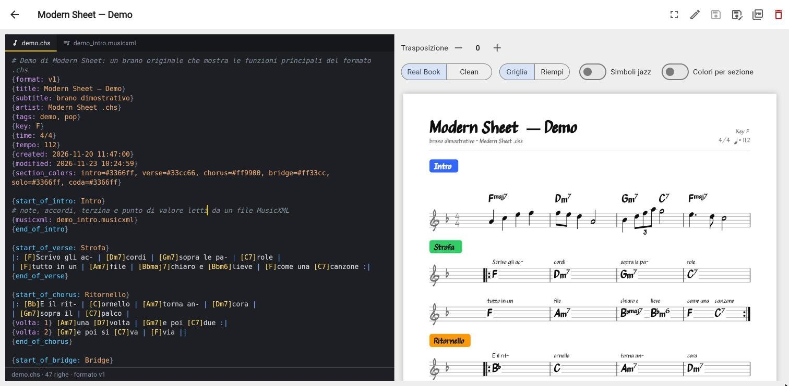
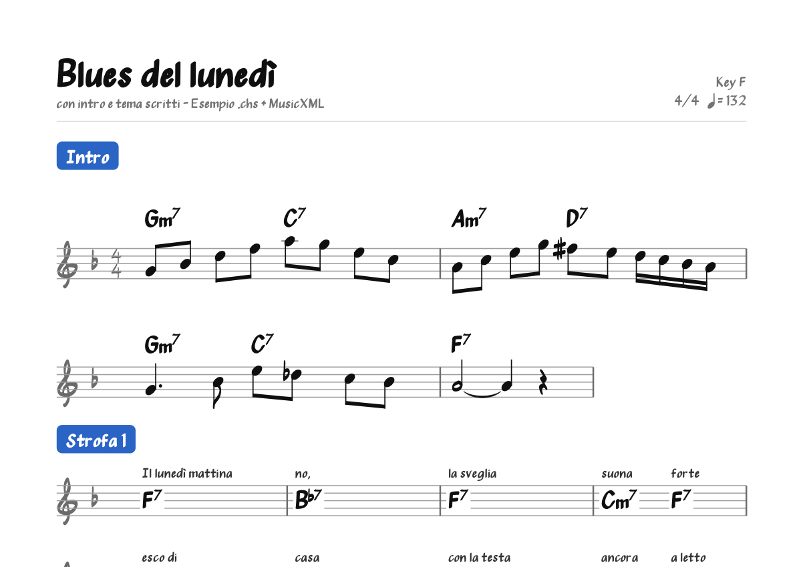
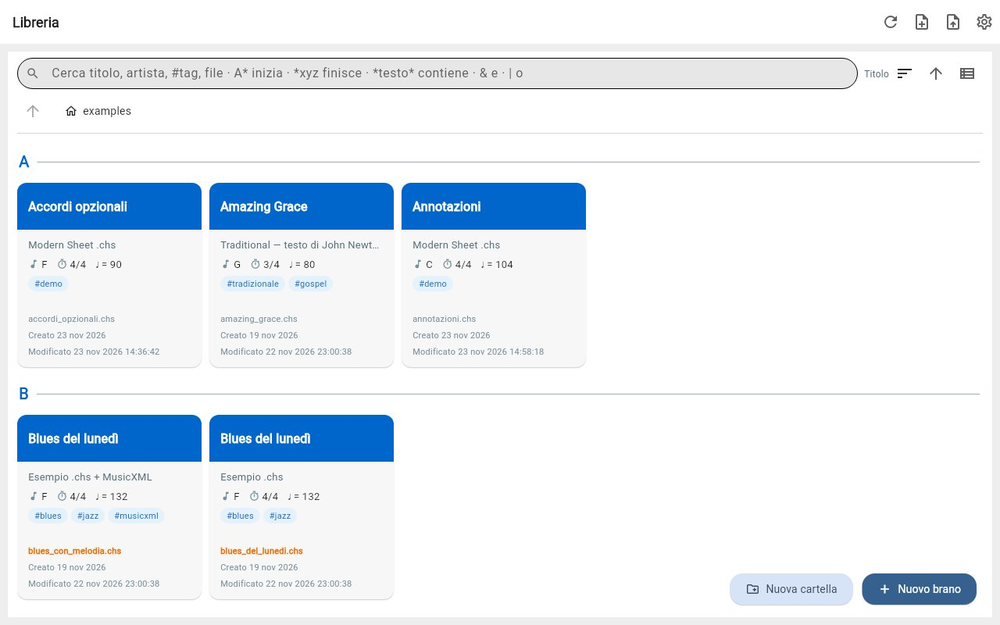

<p align="center">
  
</p>

<h1 align="center">Modern Sheet</h1>

<p align="center">
  <b>Lead sheet in stile Real Book, da un semplice file di testo.</b><br>
  Libreria di brani · editor con anteprima dal vivo · PDF · sincronizzazione con Google Drive
</p>

<p align="center">
  <a href="https://modernsheet.app">modernsheet.app</a> ·
  <a href="https://modernsheet.app/it/guida/">Guida</a> ·
  <a href="https://modernsheet.app/it/formato/">Il formato .chs</a> ·
  <a href="https://modernsheet.app/en/">English</a>
</p>

<p align="center">
  <a href="https://github.com/supermariolabs/modernsheet/actions/workflows/tests.yml"></a>
  <a href="LICENSE"></a>
  
</p>

<p align="center">
  
</p>

Scrivi gli accordi in un formato di testo leggibile (`.chs`) e Modern Sheet li impagina come in un Real Book: pentagramma, sigle con le estensioni in apice, box colorati per le sezioni, ritornelli, case di volta, segni, testo cantato. Sullo schermo, mentre scrivi, e in PDF.

> *English*: Modern Sheet turns chord charts written in a plain text format into Real Book style lead sheets, on screen and as PDF. See the [English website](https://modernsheet.app/en/).

## Funzionalità

**Il formato `.chs`**
- Testo semplice: accordi tra parentesi quadre, stanghette, sezioni, testo cantato; si scrive con qualunque editor.
- Durate in movimenti, battute con o senza stanghette, continuazioni (`%`), stop.
- Ritornelli (`x3`), case di volta 1/2/3, Segno, Coda, To Coda, D.C./D.S. al Fine, richiami di sezioni già scritte con **trasposizione automatica**.
- Cambi di tonalità (con bequadri di cortesia e nome della nuova tonalità) e di metro, anche a metà riga.
- Segni ritmici (anticipi, legature, barre ritmiche, corona, rombo), accordi opzionali, annotazioni, righe di testo.
- **Note vere da MusicXML** per intro, riff e temi, nella stessa pagina delle sigle.
- Formato versionato (`{format: v1}`): i file di oggi resteranno leggibili.

**L'impaginazione**
- Tema **Real Book** (font Petaluma scritto a mano) o **Clean**; griglia uniforme delle battute, senza sovrapposizioni.
- Trasposizione, sigle standard o jazz (Δ, –, ø, °), colori per tipo di sezione.
- Lo stesso motore produce lo schermo dell'app e il PDF: quello che vedi è quello che stampi.

**L'app** (Flet: macOS, Windows, Linux; iPad e Android in prova)
- Libreria con card, gruppi A–Z, ordinamenti, cartelle (con rinomina), ricerca con `A*`, `*testo*`, `#tag`, `&`, `|`.
- Modalità vista, schermo intero per il palco, pagine girate con tastiera o pedaliera.
- Editor scuro con evidenziazione, suggerimenti delle direttive, schede per i MusicXML, anteprima dal vivo.
- Sincronizzazione **local-first** con Google Drive o con una cartella (iCloud, Dropbox…): funziona offline, non perde nulla.
- Importazione dal tuo account **chordsheet.com** e di singoli file `.chs`.
- Interfaccia in italiano e inglese.

<p align="center">
  
  
</p>

## Un esempio

```
{format: v1}
{title: Il mio brano}
{key: G}
{time: 4/4}

{start_of_verse: Strofa}
| [G]Prima riga | [Em7]del testo | [C]e degli [D7]accordi | [G] |
{end_of_verse}

{start_of_chorus: Ritornello}
|: [C] | [D] | [Bm7] | [Em7] :|
{end_of_chorus}
```

Il riferimento completo è su [modernsheet.app/it/formato](https://modernsheet.app/it/formato/); gli esempi in [`src/examples/`](src/examples/) mostrano tutte le funzioni, con i PDF in [`examples-pdf/`](examples-pdf/).

## Avvio rapido

Serve **Python 3.10** o successivo.

```
git clone https://github.com/supermariolabs/modernsheet.git
cd modernsheet
python3 -m venv .venv
source .venv/bin/activate          # Windows: .venv\Scripts\activate
pip install -r requirements.txt
flet run                           # l'app desktop
```

Dalla riga di comando:

```
python modernsheet_cli.py src/examples/demo.chs -o out/          # PDF di un brano
python modernsheet_cli.py src/examples/*.chs --theme clean -t 3  # tema Clean, trasposto di 3 semitoni
python modernsheet_cli.py --check src/examples/*.chs             # solo controllo
python modernsheet_cli.py --from-chordsheet --pdf brano.txt      # da un testo di chordsheet.com
python modernsheet_cli.py --help
```

App compilate (`flet build`):

```
flet build macos      # serve Xcode completo e CocoaPods (brew install cocoapods)
flet build windows    # serve Visual Studio con gli strumenti C++
flet build linux
flet build ipa        # iPad/iPhone: Mac con Xcode e account Apple Developer
flet build apk        # Android
flet run --ios        # anteprima su iPad con l'app "Flet" dallo store (stessa rete Wi-Fi)
```

## Documentazione

| | |
|---|---|
| [Guida all'app](https://modernsheet.app/it/guida/) · [App guide](https://modernsheet.app/en/guide/) | installazione, libreria, editor, sincronizzazione |
| [Il formato .chs](https://modernsheet.app/it/formato/) · [The .chs format](https://modernsheet.app/en/format/) | riferimento della sintassi |
| [chordsheet.com](https://modernsheet.app/it/chordsheet/) | importare i brani di Chord Sheet Maker |
| [`SPEC.md`](SPEC.md) | specifica completa: formato, regole di impaginazione, architettura, app (in italiano) |

## Struttura del progetto

```
src/modernsheet/      motore: parser → impaginazione (DisplayList) → backend PDF / Flet / SVG
src/main.py           app Flet: libreria, editor con anteprima, impostazioni
src/assets/           font (Petaluma, DejaVu, FreeSerif), icone
src/examples/         brani di esempio (.chs + MusicXML)
examples-pdf/         PDF generati dagli esempi
modernsheet_cli.py    riga di comando
tests/                test di regressione (pytest)
tools/                make_icons.py (icone dell'app), build_site.py (sito)
site/  docs/          sorgenti del sito (Markdown, it/en) e sito generato per GitHub Pages
```

## Sviluppo

```
pytest                                   # test di regressione: devono passare sempre
python tools/build_site.py               # rigenera il sito in docs/ da site/
python tools/make_icons.py               # rigenera le icone da "MS icon.jpeg"
tools/publish_github.sh                  # prepara la pubblicazione (vedi sotto)
MODERNSHEET_LIBRARY=/una/cartella flet run   # app su una cartella di brani a scelta
```

In VS Code: *Python: Select Interpreter* → `.venv`; le configurazioni di avvio sono in `.vscode/launch.json`, i test nel pannello *Testing*. Le regole del progetto (spec e codice allineati, esempi, test, PDF rigenerati) sono in [`CLAUDE.md`](CLAUDE.md).

### Pubblicazione su GitHub

Lo sviluppo avviene sul ramo locale `main`, che non viene pubblicato. Su GitHub va il ramo `github`: ogni pubblicazione è un solo commit con i file di `main` in quel momento.

```
tools/publish_github.sh "Modern Sheet 0.36.0"    # nuovo commit su github con i file di main
git push origin github:main                       # pubblica come main su GitHub
```

### Google Drive: configurazione (una volta sola)

L'app usa un client OAuth del **tuo** progetto Google Cloud. Il file con le credenziali non va in git (`src/google_client.json` è in `.gitignore`, ma viene incluso nei pacchetti di `flet build`).

1. Su <https://console.cloud.google.com> crea un progetto (es. "Modern Sheet").
2. *API e servizi › Libreria*: abilita **Google Drive API**.
3. **Schermata di consenso** (*Google Auth Platform*, <https://console.cloud.google.com/auth/overview>):
   - *Inizia*: nome dell'app, e-mail di supporto, pubblico **Esterno**, e-mail di contatto;
   - *Accesso ai dati › Aggiungi o rimuovi ambiti*: `.../auth/drive.file`;
   - *Branding*: home page `https://modernsheet.app`, informativa sulla privacy `https://modernsheet.app/it/privacy/` (necessarie anche per mostrare il logo);
   - *Pubblico › Pubblica app*: **In produzione** (in "Test" i token scadono dopo 7 giorni). `drive.file` non è un ambito sensibile.
4. *Client › Crea client*: tipo **TV e dispositivi con input limitato**; salva il JSON come `src/google_client.json` (oppure imposta `MODERNSHEET_GOOGLE_CLIENT_ID` e `MODERNSHEET_GOOGLE_CLIENT_SECRET`).
5. Nell'app: *Impostazioni › Sincronizzazione › Google Drive › Collega*.

L'app crea nel Drive la cartella **Modern Sheet** (il nome si cambia nelle impostazioni) e vede solo i file che crea lei.

## Licenza

Modern Sheet è software libero, distribuito con la licenza **GNU General Public License v3.0 o successiva**: vedi [`LICENSE`](LICENSE).

I font inclusi hanno le loro licenze, in [`src/assets/fonts/`](src/assets/fonts/): Petaluma e Petaluma Script (SIL Open Font License), DejaVu (licenza Bitstream Vera/DejaVu), FreeSerif (GNU FreeFont, GPL con eccezione per i font). Gli esempi sono brani originali o di pubblico dominio.
